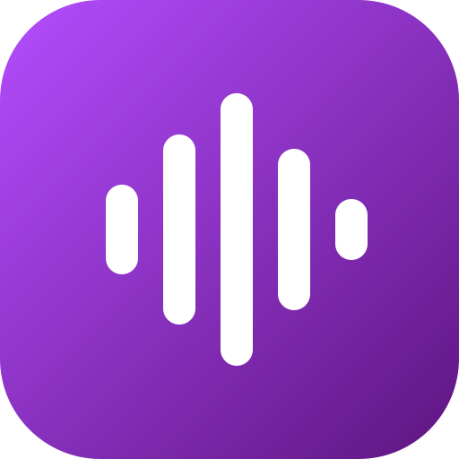
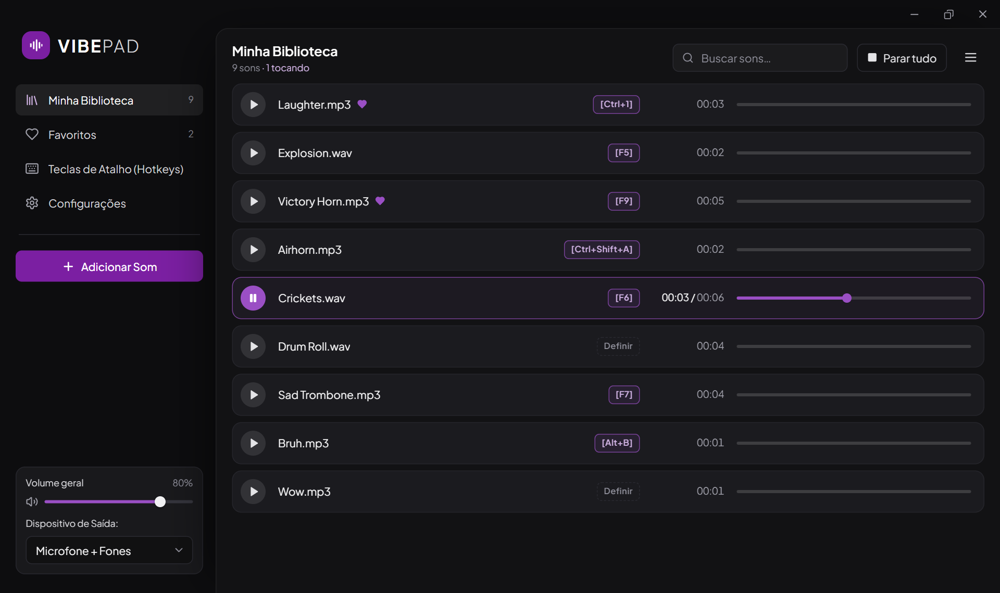
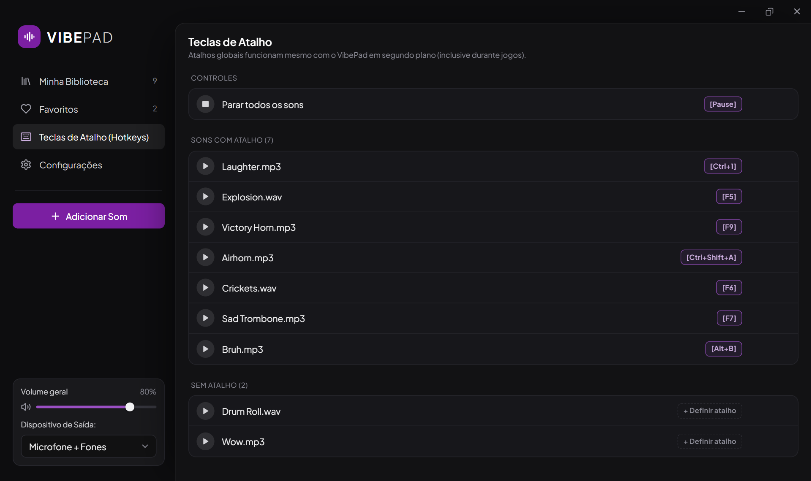
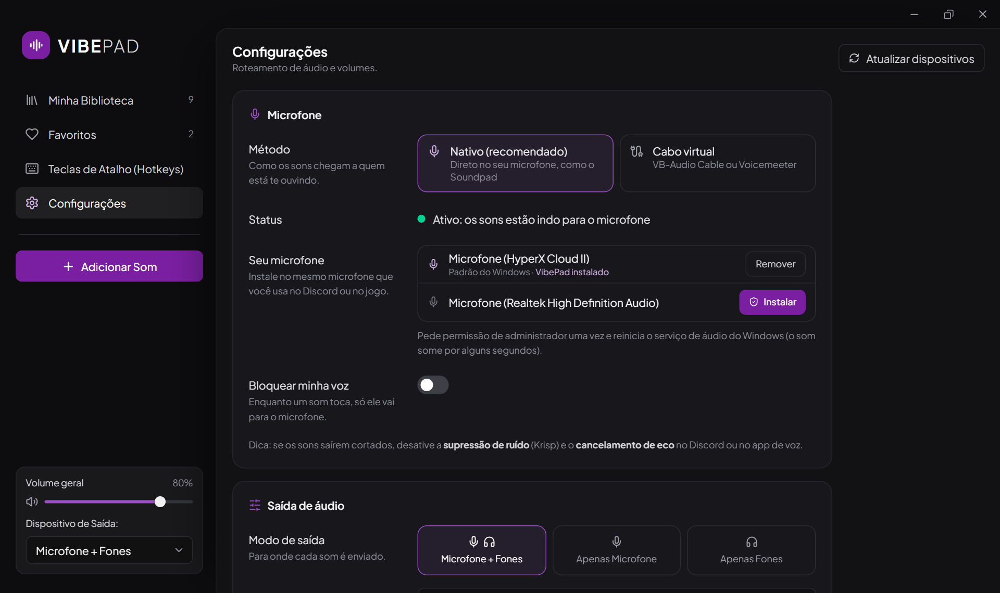

  

<h1 align="center">VIBEPAD</h1>

  <strong>Toque sons direto no seu microfone, com um atalho de teclado.</strong> 
  Um soundboard para Windows, para usar no Discord, nos jogos e nas lives.

  <a href="https://github.com/Spideco/VIBEPAD/releases/latest"><strong>⬇ Baixar a versão mais recente</strong></a>

## O que é o VibePad

O VibePad é um aplicativo para tocar efeitos sonoros, memes e músicas **no seu microfone**: quem está na call ou no jogo com você escuta o som como se fosse a sua voz. Você também ouve tudo nos seus fones, para saber o que está tocando.

Você monta a sua biblioteca de sons, define um atalho para cada um e dispara os sons a qualquer momento, mesmo com o VibePad minimizado e você no meio de uma partida.

## Destaques

- **Direto no seu microfone:** sem instalar cabo virtual e sem trocar o microfone no Discord ou no jogo. É só escolher o microfone que você já usa e clicar em **Instalar**.
- **Atalhos globais:** cada som pode ter a sua tecla ou combinação, e elas funcionam mesmo com o app em segundo plano. Tem também um atalho para **parar todos os sons**.
- **Barra de reprodução:** pause, continue e pule para qualquer parte do som, como num player de vídeo.
- **Controle de volume:** volume geral, volume de cada som e um volume separado só para os seus fones.
- **Biblioteca organizada:** busca, favoritos e ordenação. É só arrastar os arquivos para a janela para adicionar.
- **Convive com outros apps de áudio:** funciona junto com o Equalizer APO e mantém a sua supressão de ruído funcionando na sua voz.
- **Formatos comuns:** MP3, WAV, OGG, FLAC e M4A.

## Telas

| Teclas de atalho | Configurações do microfone |
|---|---|
|  |  |

## Como começar

1. **Baixe e instale** o VibePad pela [página de versões](https://github.com/Spideco/VIBEPAD/releases/latest). O arquivo recomendado é o `VibePad_x.y.z_x64-setup.exe`.
2. **Adicione seus sons** com o botão **Adicionar Som** ou arrastando os arquivos para a janela.
3. **Instale no seu microfone:** em **Configurações → Microfone**, clique em **Instalar** ao lado do microfone que você usa no Discord ou no jogo. O Windows vai pedir permissão de administrador uma vez.
4. **Defina os atalhos:** clique em **Definir** ao lado de um som e aperte a tecla ou combinação que quiser.
5. Pronto: aperte o atalho durante a call ou o jogo e todo mundo vai ouvir.

## Requisitos

- Windows 10 ou 11 (64 bits)
